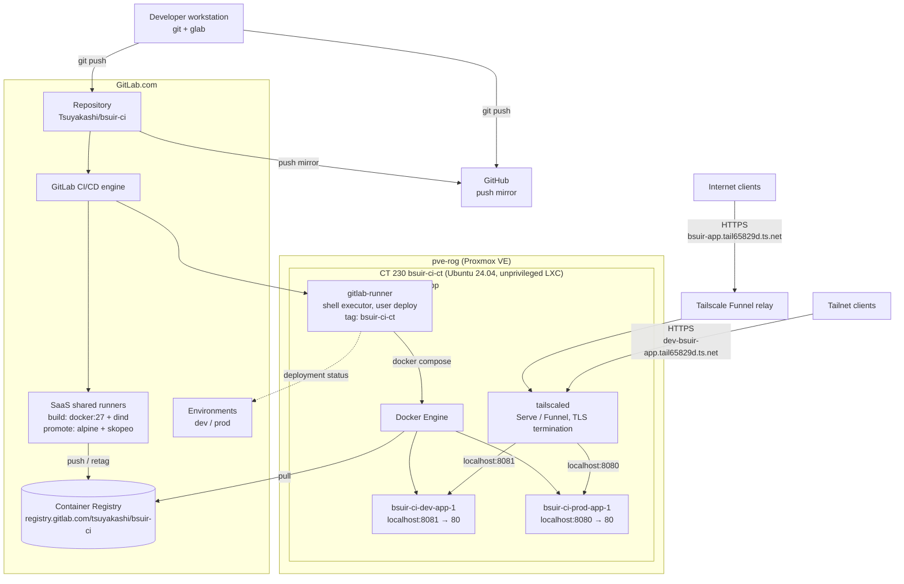
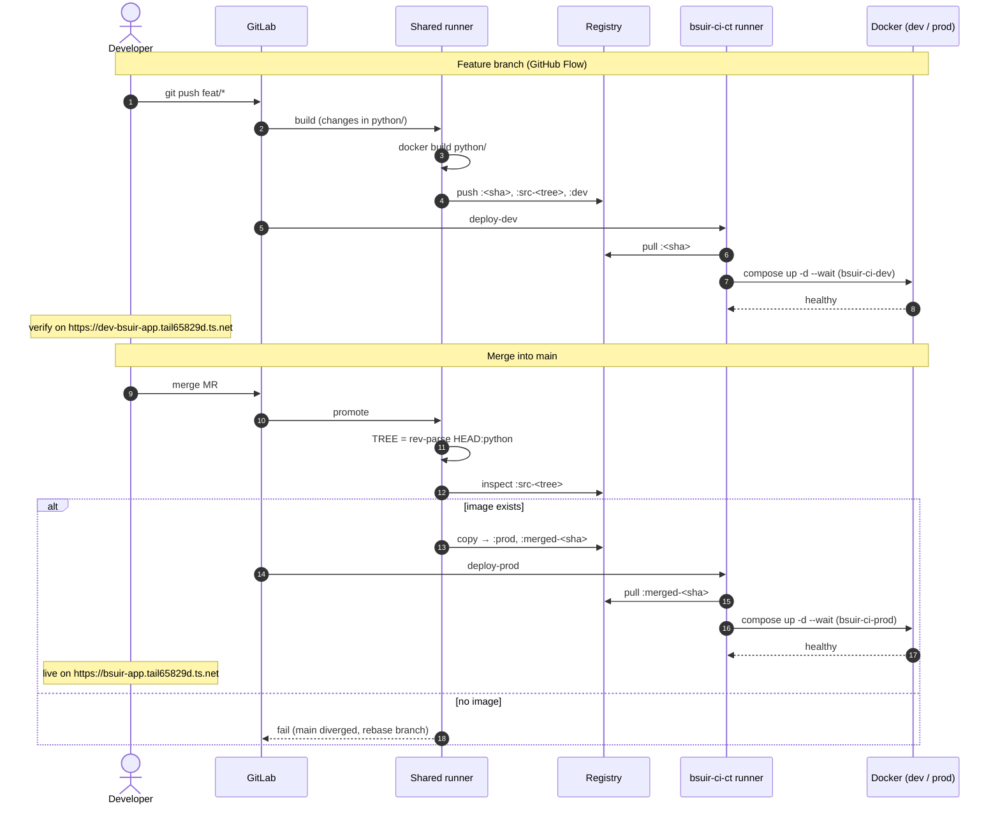
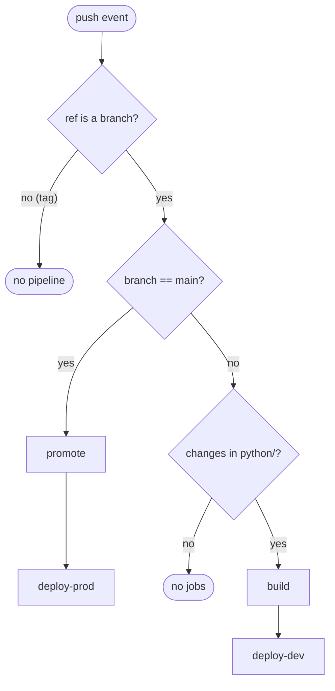
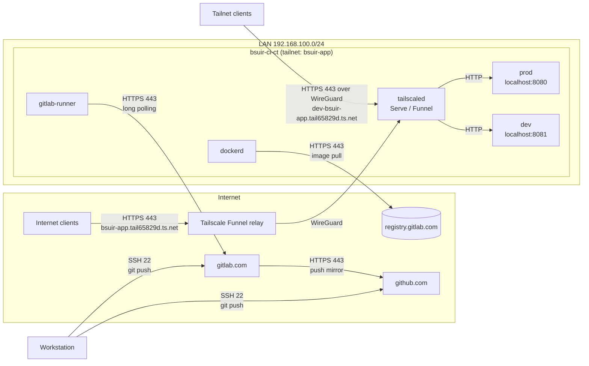

# BSUIR CI

Flask app with GitLab CI/CD: build on feature branches, promote on merge, deploy to dev/prod on a self-hosted runner.

## Diagrams

### Deployment



### Sequence



### Pipeline rules



### Promote


### Network flows



## Pipeline

| Event | Jobs | Result |
|---|---|---|
| Push to feature branch (changes in `python/`) | `build` → `deploy-dev` | Image built, deployed to dev (`:8081`) |
| Push to feature branch (docs only) | — | Nothing |
| MR merged into `main` | `promote` → `deploy-prod` | Image retagged, deployed to prod (`:8080`) |
| Direct push to `main` | — | Blocked by branch protection |

### Image tags

| Tag | Set by | Meaning |
|---|---|---|
| `<commit sha>` | `build` | Commit the image was built from |
| `src-<tree>` | `build` | Hash of `python/` tree — content-based lookup key for `promote` |
| `dev` | `build` | Latest feature branch build |
| `prod` | `promote` | Current production image |
| `merged-<sha>` | `promote` | Image released by this merge commit (immutable, used for rollback) |

`promote` finds the image by `python/` tree hash, so prod gets exactly the app content built on the feature branch, regardless of docs commits or merge method. If `main` diverged in `python/` while the MR was open, `promote` fails — rebase the branch.

### Rollback

Deployments → Environments → `prod` → Re-deploy an older deployment. Or manually:
```
skopeo copy --all docker://registry.gitlab.com/tsuyakashi/bsuir-ci:merged-<old_sha> docker://registry.gitlab.com/tsuyakashi/bsuir-ci:prod
```

## Infrastructure

Single LXC `bsuir-ci-ct` (CT 230 on `pve-rog`): GitLab runner (shell executor, user `deploy`) + Docker, dev and prod as separate compose projects (`bsuir-ci-dev`, `bsuir-ci-prod`). Reachable via Tailscale.

## Cheatsheet

### Protect the main branch
```
glab api -X DELETE projects/:id/protected_branches/main
glab api -X POST projects/:id/protected_branches -f name=main -f push_access_level=0 -f merge_access_level=40
```

### Create LXC
```
pct create 230 local:vztmpl/ubuntu-24.04-standard_24.04-2_amd64.tar.zst \
  --hostname bsuir-ci-ct \
  --cores 1 --memory 1024 --swap 512 \
  --rootfs local-lvm:8 \
  --net0 name=eth0,bridge=vmbr0,ip=dhcp \
  --nameserver 1.1.1.1 \
  --dev0 /dev/net/tun \
  --unprivileged 1 \
  --features nesting=1,keyctl=1 \
  --ssh-public-keys ~/.ssh/authorized_keys \
  --onboot 1 \
  --start 1
```
- `--nameserver` — otherwise the CT inherits host MagicDNS (`100.100.100.100`), unreachable before Tailscale is up
- `--dev0 /dev/net/tun` — required by Tailscale
- `nesting=1` — required by Docker

### Tailscale (in CT)
```
curl -fsSL https://tailscale.com/install.sh | sh
tailscale up --hostname bsuir-ci-ct --ssh
```

### Docker (in CT)
```
curl -fsSL https://get.docker.com | sh
docker run --rm hello-world
```

### Deploy user and runner (in CT, as root)
```
useradd -m -s /bin/bash deploy
usermod -aG docker deploy
rm -f /home/deploy/.bash_logout   # breaks shell executor on Ubuntu

curl -fsSL https://packages.gitlab.com/install/repositories/runner/gitlab-runner/script.deb.sh | bash
apt install -y gitlab-runner
gitlab-runner uninstall
gitlab-runner install --user deploy --working-directory /home/deploy
systemctl restart gitlab-runner
```

### Register runner
On the workstation:
```
glab api -X POST user/runners \
  -f runner_type=project_type \
  -F project_id=$(glab api projects/:id | jq .id) \
  -F 'tag_list=["bsuir-ci-ct"]' \
  -F run_untagged=false \
  -f description=bsuir-ci-ct | jq -r .token
```
In CT:
```
gitlab-runner register --non-interactive --url https://gitlab.com --token glrt-... --executor shell
gitlab-runner verify
```
