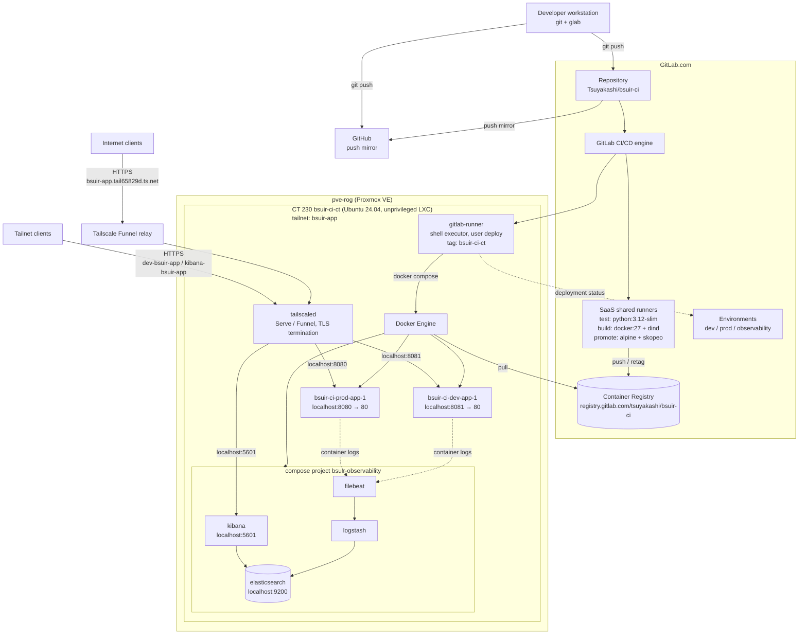
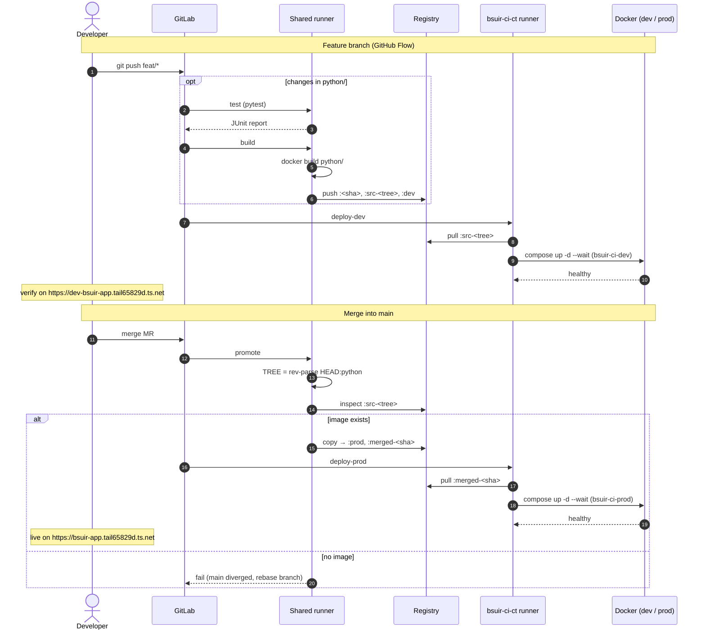
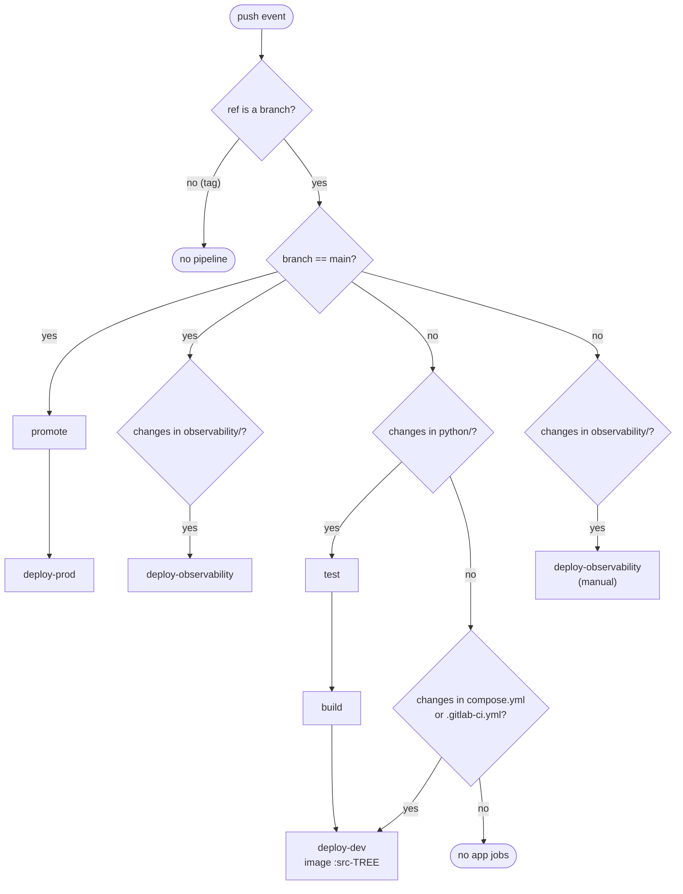
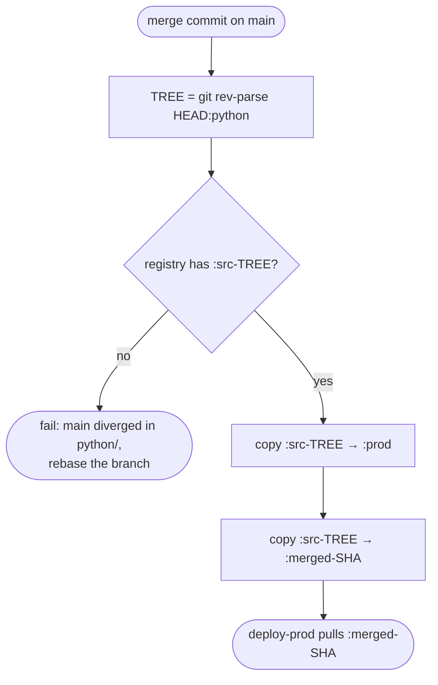
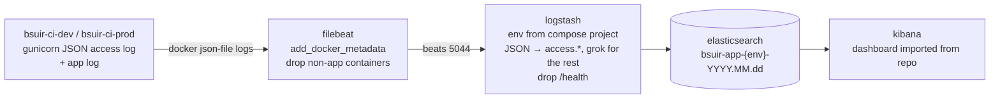
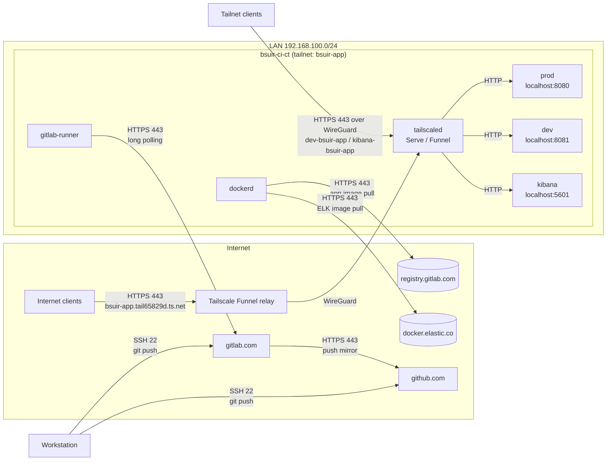

# BSUIR CI

Flask app with GitLab CI/CD: test and build on feature branches, promote on merge, deploy to dev/prod on a self-hosted runner. Application logs are shipped to an ELK stack (Filebeat → Logstash → Elasticsearch → Kibana) on the same host.

| Environment | URL | Access |
|---|---|---|
| prod | https://bsuir-app.tail65829d.ts.net | Public (Tailscale Funnel) |
| dev | https://dev-bsuir-app.tail65829d.ts.net | Tailnet admins only (Tailscale Service) |
| Kibana | https://kibana-bsuir-app.tail65829d.ts.net | Tailnet admins only (Tailscale Service) |

## Diagrams

### Deployment



### Sequence



### Pipeline rules



### Promote



### Log pipeline



### Network flows



## Pipeline

| Event | Jobs | Result |
|---|---|---|
| Push to feature branch (changes in `python/`) | `test` → `build` → `deploy-dev` | Tests passed, image built, deployed to dev |
| Push to feature branch (only `compose.yml` / `.gitlab-ci.yml`) | `deploy-dev` | Existing image (`src-<tree>`) redeployed to dev with new config |
| Push to feature branch (changes in `observability/`) | `deploy-observability` (manual) | Stack can be redeployed from the branch on demand |
| Push to feature branch (docs only) | — | Nothing |
| MR merged into `main` | `promote` → `deploy-prod` | Image retagged, deployed to prod |
| MR merged into `main` (changes in `observability/`) | `deploy-observability` | Stack redeployed, index template and Kibana objects applied |
| Direct push to `main` | — | Blocked by branch protection |

### Image tags

| Tag | Set by | Meaning |
|---|---|---|
| `<commit sha>` | `build` | Commit the image was built from (traceability) |
| `src-<tree>` | `build` | Hash of `python/` tree — content-based key used by `deploy-dev` and `promote` |
| `dev` | `build` | Latest feature branch build |
| `prod` | `promote` | Current production image |
| `merged-<sha>` | `promote` | Image released by this merge commit (immutable, deployed to prod, used for rollback) |

`promote` finds the image by `python/` tree hash, so prod gets exactly the app content built on the feature branch, regardless of docs commits or merge method. If `main` diverged in `python/` while the MR was open, `promote` fails — rebase the branch.

### Tests

`test` runs `pytest` in `python:3.12-slim` on feature branches with changes in `python/`, before `build`. A failed test stops the pipeline: no image, no dev deploy. Results are published as a JUnit report and shown in the MR widget.

Run locally:
```
cd python
docker run --rm -it -v "$PWD":/app -w /app python:3.12-slim sh -c "pip install -r requirements.txt pytest && python -m pytest -v"
```

### Deploy

Each environment is a separate compose project (`bsuir-ci-dev`, `bsuir-ci-prod`) from the same `compose.yml`, parametrized by `IMAGE_TAG` and `PORT`. Ports are published on `127.0.0.1` only — the apps are reachable solely through Tailscale.

`docker compose up --wait` blocks until the container healthcheck (`GET /health` inside the container) passes, so a container that fails to start fails the deploy job. Unused images are pruned after each deploy.

### Rollback

Deployments → Environments → `prod` → Re-deploy an older deployment. Or manually:
```
skopeo copy --all docker://registry.gitlab.com/tsuyakashi/bsuir-ci:merged-<old_sha> docker://registry.gitlab.com/tsuyakashi/bsuir-ci:prod
```

## Application

Flask app served by gunicorn (`python/gunicorn.conf.py`, 2 workers, non-root user). Endpoints: `/` (timestamp and 1-minute load average from `/proc/loadavg`) and `/health`.

Behind Tailscale Serve/Funnel the client IP arrives in `X-Forwarded-For`. The app trusts exactly one proxy hop (`ProxyFix(x_for=1)`), which is safe because ports are bound to localhost and only `tailscaled` can reach them.

The access log is written by gunicorn as one JSON object per line:
```
{"time":"[03/Nov/2026:14:05:58 +0000]","remote":"100.75.99.19","method":"GET","path":"/","query":"","status":200,"bytes":297,"duration_ms":3,"user_agent":"curl/8.18.0"}
```
`remote` is the real client (from `X-Forwarded-For`), `-` for requests without a proxy (docker healthcheck, local curl).

## Observability

`observability/compose.yml`, compose project `bsuir-observability`, all images pinned to `9.5.6`:

| Service | Role | Limits |
|---|---|---|
| `filebeat` | Reads `/var/lib/docker/containers/*/*.log`, enriches with docker metadata, keeps only `bsuir-ci-dev` / `bsuir-ci-prod` containers | 256 MB |
| `logstash` | Sets `env` (`dev`/`prod`) from the compose project label, parses JSON access log into `access.*`, grok for other lines, drops `/health` | 768 MB, heap 256 MB |
| `elasticsearch` | Single node, daily indices `bsuir-app-{env}-YYYY.MM.dd`, `localhost:9200` | 2 GB, heap 1 GB |
| `kibana` | UI on `localhost:5601`, exposed via Tailscale Service `svc:kibana-bsuir-app` | 1.2 GB |

`deploy-observability` brings the stack up, then:
- applies index template `bsuir-app` with `number_of_replicas: 0` (single node — otherwise indices stay yellow) and updates existing indices;
- imports `observability/kibana/dashboards.ndjson` (data view `bsuir-app` + dashboard) with `overwrite=true`.

Dashboard panels: requests over time by environment, unique visitors (metric), unique visitors over time. A visitor is a unique `access.remote` — an IP address, so users behind one NAT count as one, one user with several networks counts as several.

To change the dashboard: edit it in Kibana, then export back into the repo:
```
ssh root@bsuir-app "curl -s -X POST localhost:5601/api/saved_objects/_export -H 'kbn-xsrf: true' -H 'Content-Type: application/json' -d '{\"type\":[\"dashboard\"],\"includeReferencesDeep\":true}'" > observability/kibana/dashboards.ndjson
```

Elasticsearch security is disabled on purpose: every port is bound to `127.0.0.1` and Kibana is reachable only by tailnet admins, so access is restricted at the network level.

## Infrastructure

Single LXC `bsuir-ci-ct` (CT 230 on `pve-rog`, tailnet node `bsuir-app`, `tag:bsuir`): GitLab runner (shell executor, user `deploy`), Docker, dev and prod as separate compose projects, plus the observability stack.

Prod is published to the internet via Tailscale Funnel on the node name. Dev and Kibana are tailnet-only Tailscale Services (`svc:dev-bsuir-app`, `svc:kibana-bsuir-app`) with their own names. Funnel does not support Services, hence the asymmetric setup.

## Run locally

```
docker build -t bsuir-app python/
docker run --rm -p 8080:80 bsuir-app
curl http://localhost:8080/health
```

## Cheatsheet

### Protect the main branch
```
glab api -X DELETE projects/:id/protected_branches/main
glab api -X POST projects/:id/protected_branches -f name=main -f push_access_level=0 -f merge_access_level=40
```

### Create LXC
```
pct create 230 local:vztmpl/ubuntu-24.04-standard_24.04-2_amd64.tar.zst \
  --hostname bsuir-ci-ct \
  --cores 3 --memory 5120 --swap 1024 \
  --rootfs local-lvm:24 \
  --net0 name=eth0,bridge=vmbr0,ip=dhcp \
  --nameserver 1.1.1.1 \
  --dev0 /dev/net/tun \
  --unprivileged 1 \
  --features nesting=1,keyctl=1 \
  --ssh-public-keys ~/.ssh/authorized_keys \
  --onboot 1 \
  --start 1
```
- `--nameserver` — otherwise the CT inherits host MagicDNS (`100.100.100.100`), unreachable before Tailscale is up
- `--dev0 /dev/net/tun` — required by Tailscale
- `nesting=1` — required by Docker
- 3 cores / 5 GB / 24 GB — sized for the apps plus the ELK stack
- Elasticsearch needs `vm.max_map_count >= 262144` on the Proxmox host (not settable from an unprivileged CT); current Proxmox defaults already exceed it, check with `sysctl vm.max_map_count`

### Tailscale

Order matters: ACL → tagged node → service definitions → serve/funnel.

1. ACL (tailnet policy file, managed separately). Relevant parts:
```
"tagOwners": {
    "tag:bsuir": ["autogroup:admin"],
},
"grants": [
    {
        "src": ["autogroup:admin"],
        "dst": ["svc:dev-bsuir-app"],
        "ip":  ["tcp:443"],
    },
    {
        "src": ["autogroup:admin"],
        "dst": ["svc:kibana-bsuir-app"],
        "ip":  ["tcp:443"],
    },
],
"autoApprovers": {
    "services": {
        "svc:dev-bsuir-app":    ["tag:bsuir"],
        "svc:kibana-bsuir-app": ["tag:bsuir"],
    },
},
"nodeAttrs": [
    // tagged nodes are not autogroup:member, so funnel is granted separately
    {
        "target": ["tag:bsuir"],
        "attr":   ["funnel"],
    },
],
```

2. Join the tailnet with the tag (in CT):
```
curl -fsSL https://tailscale.com/install.sh | sh
tailscale up --hostname=bsuir-app --ssh --advertise-tags=tag:bsuir
```
For an already joined, user-owned node, changing tags requires re-authentication (`tailscale up` prints a login URL).

3. Define the services in the admin console: Services → Add service → `dev-bsuir-app` and `kibana-bsuir-app`, endpoint `tcp:443` for both.

4. Expose (in CT):
```
# prod: public via Funnel on the node name (bsuir-app.<tailnet>)
tailscale funnel --bg 8080

# dev: tailnet-only Tailscale Service (dev-bsuir-app.<tailnet>)
tailscale serve --service=svc:dev-bsuir-app --https=443 127.0.0.1:8081

# kibana: tailnet-only Tailscale Service (kibana-bsuir-app.<tailnet>)
tailscale serve --service=svc:kibana-bsuir-app --https=443 127.0.0.1:5601
```

If the host advertised a service before it was defined in the console, the service stays at 0 hosts. Re-advertise:
```
systemctl restart tailscaled
tailscale serve drain svc:<name> && sleep 3 && tailscale serve advertise svc:<name>
```

### Docker (in CT)
```
curl -fsSL https://get.docker.com | sh
docker run --rm hello-world
```

### Deploy user and runner (in CT, as root)
```
useradd -m -s /bin/bash deploy
usermod -aG docker deploy
rm -f /home/deploy/.bash_logout   # breaks shell executor on Ubuntu

curl -fsSL https://packages.gitlab.com/install/repositories/runner/gitlab-runner/script.deb.sh | bash
apt install -y gitlab-runner
gitlab-runner uninstall
gitlab-runner install --user deploy --working-directory /home/deploy
systemctl restart gitlab-runner
```

### Register runner
On the workstation:
```
glab api -X POST user/runners \
  -f runner_type=project_type \
  -F project_id=$(glab api projects/:id | jq .id) \
  -F 'tag_list=["bsuir-ci-ct"]' \
  -F run_untagged=false \
  -f description=bsuir-ci-ct | jq -r .token
```
In CT:
```
gitlab-runner register --non-interactive --url https://gitlab.com --token glrt-... --executor shell
gitlab-runner verify
```

### Useful checks
```
# observability stack and indices
ssh root@bsuir-app "docker compose -p bsuir-observability ps; curl -s 'localhost:9200/_cat/indices/bsuir-app-*?v'"

# app access log
ssh root@bsuir-app "docker logs bsuir-ci-prod-app-1 2>&1 | tail"

# tailscale serve/funnel config
ssh root@bsuir-app "tailscale serve status"
```
